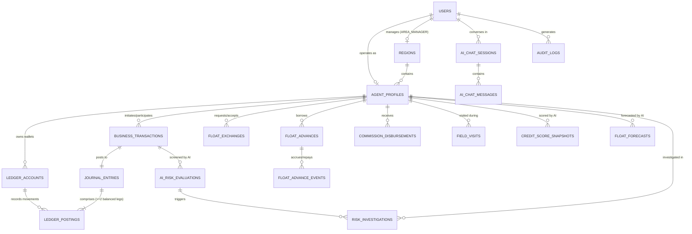

# Database Design — PostgreSQL & Flyway Double-Entry Schema

## 1. Database Design Principles

- **Engine**: PostgreSQL 16 (built-in `gen_random_uuid()`), `JSONB` for AI feature attributions, simulation parameters and audit snapshots.
- **Migrations**: Managed by **Flyway** (`backend/src/main/resources/db/migration/V1__*.sql` through `V4__*.sql`). Hibernate runs in `ddl-auto: validate` mode, so the application refuses to start if entities and schema drift.
- **Monetary Precision**: Every monetary column uses `NUMERIC(19, 4)` (`BigDecimal` in Java, rounded to cents with banker's rounding at the service layer). Floating-point types are never used for money; rates and scores use narrower `NUMERIC` types.
- **Double-Entry Integrity**: `ledger_accounts.balance` is a materialized balance updated only by `LedgerService` in the same database transaction that inserts the journal's `ledger_entries` (`CHECK (amount > 0)`). Accounts are locked in a deterministic order (`SELECT … FOR UPDATE`) and carry a `version` column for optimistic locking. `CHECK (allow_negative OR balance >= 0)` makes overdrafts impossible at the database level.
- **Immutability (database-enforced)**: triggers reject `UPDATE`/`DELETE` on `ledger_entries` and `audit_logs`, protect the financial fields of `financial_transactions`, and a deferred constraint trigger verifies that every journal balances (Σ debits = Σ credits) at commit.

## 1a. Implemented Schema (authoritative)

The migrations are the source of truth. Section 4 below records the original design and differs in naming
(e.g. `ledger_postings` → `ledger_entries`, `regions` → `areas`, `risk_investigations` → `investigations`).

| Migration | Tables |
| :--- | :--- |
| `V1__identity_and_areas.sql` | `areas`, `users`, `refresh_tokens`, `revoked_access_tokens` |
| `V2__agents_customers_ledger.sql` | `agents`, `agent_accounts`, `customers`, `ledger_accounts`, `financial_transactions`, `ledger_entries` + immutability and balanced-journal triggers |
| `V3__financial_operations.sql` | `tariff_rules`, `commissions`, `commission_disbursements`, `float_advances`, `advance_repayments`, `float_exchanges`, `float_replenishments` |
| `V4__risk_ai_notifications_audit.sql` | `fraud_checks`, `credit_scores`, `float_predictions`, `investigations`, `investigation_notes`, `notifications`, `audit_logs`, `simulation_runs`, `system_settings`, sequence `investigation_case_seq` |

Agent balances (the `AgentBalance` concept) are the agent's `ledger_accounts` rows by `balance_type`:
`EFLOAT`, `CASH`, `COMMISSION_PAYABLE`, `ADVANCE_PRINCIPAL`, `ADVANCE_INTEREST`. Areas own `AREA_EFLOAT_POOL`
and `AREA_CASH_POOL`; customers own `CUSTOMER_WALLET`; system accounts are `SETTLEMENT_BANK`,
`CENTRAL_CASH_VAULT`, `CASH_CONTROL` (the only account allowed to go negative), `OPENING_EQUITY`, `FEE_INCOME`,
`INTEREST_INCOME` and `COMMISSION_EXPENSE`. Every money movement is a `financial_transactions` row whose
`idempotency_key` is `UNIQUE`; `float_advances` and `float_exchanges` also carry their own unique key for the
request/proposal step. Repayments, disbursements and replenishments are idempotent through their linked
financial transaction.

---

## 2. Entity-Relationship Overview



---

## 3. Chart of Accounts & Double-Entry Posting Rules

### 3.1 Account Types & Normal Balances
| Account Category | Normal Side | Balance Effect on `DEBIT` | Balance Effect on `CREDIT` | Code Prefix |
| :--- | :--- | :--- | :--- | :--- |
| `ASSET` | `DEBIT` | `+ amount` | `- amount` | `1xxx` |
| `LIABILITY` | `CREDIT` | `- amount` | `+ amount` | `2xxx` |
| `EQUITY` | `CREDIT` | `- amount` | `+ amount` | `3xxx` |
| `REVENUE` | `CREDIT` | `- amount` | `+ amount` | `4xxx` |
| `EXPENSE` | `DEBIT` | `+ amount` | `- amount` | `5xxx` |

### 3.2 System & Per-Agent Ledger Accounts
- **System / Treasury Accounts (`owner_type = 'SYSTEM'`)**:
  - `1000-CENTRAL-RESERVE` (`ASSET`): Central Platform Digital Float Reserve.
  - `1400-CUSTOMER-CLEARING` (`ASSET`): Simulated Customer Bank & Mobile Wallet Settlement Clearing.
  - `3000-PLATFORM-EQUITY` (`EQUITY`): Initial Platform Treasury Capitalization.
  - `4100-FEE-REVENUE` (`REVENUE`): Transaction Fee Income.
  - `4200-INTEREST-REVENUE` (`REVENUE`): Float Advance Interest Income.
  - `5100-COMMISSION-EXPENSE` (`EXPENSE`): Agent Commission Expense.
- **Regional Accounts (`owner_type = 'REGION'`)**:
  - `1100-AREA-FLOAT-POOL-{regionCode}` (`ASSET`): Regional E-Float Pool managed by Area Manager.
  - `1110-AREA-CASH-VAULT-{regionCode}` (`ASSET`): Regional Physical Cash Transit Vault managed by Area Manager.
- **Per-Agent Accounts (`owner_type = 'AGENT'`)**:
  - `1200-AGENT-EFLOAT-{agentCode}` (`ASSET`): Agent's Digital E-Float Wallet (`CHECK (current_balance >= 0)`).
  - `1300-AGENT-CASH-{agentCode}` (`ASSET`): Agent's Physical Cash Till (`CHECK (current_balance >= 0)`).
  - `1500-LOAN-PRINCIPAL-REC-{agentCode}` (`ASSET`): Platform's Float Advance Principal Receivable from Agent.
  - `1510-LOAN-INTEREST-REC-{agentCode}` (`ASSET`): Platform's Accrued Interest Receivable from Agent.
  - `2100-COMMISSION-PAYABLE-{agentCode}` (`LIABILITY`): Accrued Commissions owed to Agent (Agent Commission Wallet).
  - `2200-ADVANCE-PAYABLE-{agentCode}` (`LIABILITY`): Agent's Float Advance Principal Obligation.
  - `2210-INTEREST-PAYABLE-{agentCode}` (`LIABILITY`): Agent's Accrued Interest Obligation.
  - `3100-AGENT-CAPITAL-{agentCode}` (`EQUITY`): Agent's Working Capital & Settled Earnings Equity.
  - `5200-AGENT-INTEREST-EXP-{agentCode}` (`EXPENSE`): Agent's Interest Expense sub-account.

### 3.3 Balanced Double-Entry Templates for All Core Operations

1. **Customer Cash Deposit** (Amount $A$, Fee $F$, Commission $C$):
   - `DEBIT` `1300-AGENT-CASH` $(A + F)$ / `CREDIT` `1200-AGENT-EFLOAT` $(A + F)$ *(Agent takes physical cash, dispatches digital value)*
   - If $F > 0$: `DEBIT` `1000-CENTRAL-RESERVE` $F$ / `CREDIT` `4100-FEE-REVENUE` $F$
   - If $C > 0$: `DEBIT` `5100-COMMISSION-EXPENSE` $C$ / `CREDIT` `2100-COMMISSION-PAYABLE` $C$

2. **Customer Cash Withdrawal** (Amount $A$, Fee $F$, Commission $C$):
   - `DEBIT` `1200-AGENT-EFLOAT` $A$ / `CREDIT` `1300-AGENT-CASH` $A$ *(Agent receives digital float, hands out physical cash)*
   - If $F > 0$: `DEBIT` `1400-CUSTOMER-CLEARING` $F$ / `CREDIT` `4100-FEE-REVENUE` $F$
   - If $C > 0$: `DEBIT` `5100-COMMISSION-EXPENSE` $C$ / `CREDIT` `2100-COMMISSION-PAYABLE` $C$

3. **Agent Money Transfer** (Amount $A$, Fee $F$, Commission $C$):
   - *Walk-in Cash-Funded Transfer*: `DEBIT` `1300-AGENT-CASH` $(A + F)$ / `CREDIT` `1200-AGENT-EFLOAT` $(A + F)$
   - *Fee Recognition*: `DEBIT` `1000-CENTRAL-RESERVE` $F$ / `CREDIT` `4100-FEE-REVENUE` $F$
   - *If Destined for Recipient Agent Payout*: `DEBIT` `1200-AGENT-EFLOAT-{recipient}` $A$ / `CREDIT` `1400-CUSTOMER-CLEARING` $A$ (optional corridor leg when target agent is specified)
   - *Commission Recognition*: `DEBIT` `5100-COMMISSION-EXPENSE` $C$ / `CREDIT` `2100-COMMISSION-PAYABLE` $C$

4. **Agent-to-Agent Float Exchange** (Amount $A$, Initiator gives E-Float for Peer's Cash):
   - `DEBIT` `1200-AGENT-EFLOAT-{peer}` $A$ / `CREDIT` `1200-AGENT-EFLOAT-{initiator}` $A$
   - `DEBIT` `1300-AGENT-CASH-{initiator}` $A$ / `CREDIT` `1300-AGENT-CASH-{peer}` $A$

5. **Area Manager Float Replenishment** (Amount $A$):
   - *Mode `CASH_COLLECTION_SWAP`* (Field cash pickup for E-Float):
     - `DEBIT` `1200-AGENT-EFLOAT` $A$ / `CREDIT` `1100-AREA-FLOAT-POOL` $A$
     - `DEBIT` `1110-AREA-CASH-VAULT` $A$ / `CREDIT` `1300-AGENT-CASH` $A$
   - *Mode `DIRECT_LIQUIDITY_INJECTION`* (Bank-settled top-up):
     - `DEBIT` `1200-AGENT-EFLOAT` $A$ / `CREDIT` `1100-AREA-FLOAT-POOL` $A$
     - `DEBIT` `1000-CENTRAL-RESERVE` $A$ / `CREDIT` `3100-AGENT-CAPITAL` $A$

6. **Float Advance Principal Disbursement** (Principal $P$):
   - `DEBIT` `1200-AGENT-EFLOAT` $P$ / `CREDIT` `2200-ADVANCE-PAYABLE` $P$
   - `DEBIT` `1500-LOAN-PRINCIPAL-REC` $P$ / `CREDIT` `1000-CENTRAL-RESERVE` $P$

7. **Float Advance Interest Accrual** (Interest $I$):
   - `DEBIT` `1510-LOAN-INTEREST-REC` $I$ / `CREDIT` `4200-INTEREST-REVENUE` $I$
   - `DEBIT` `5200-AGENT-INTEREST-EXP` $I$ / `CREDIT` `2210-INTEREST-PAYABLE` $I$

8. **Float Advance Repayment** (Principal Part $P_r$, Interest Part $I_r$, Total $T = P_r + I_r$):
   - `DEBIT` `2200-ADVANCE-PAYABLE` $P_r$ + `DEBIT` `2210-INTEREST-PAYABLE` $I_r$ / `CREDIT` `1200-AGENT-EFLOAT` $T$
   - `DEBIT` `1000-CENTRAL-RESERVE` $T$ / `CREDIT` `1500-LOAN-PRINCIPAL-REC` $P_r$ + `CREDIT` `1510-LOAN-INTEREST-REC` $I_r$

9. **Commission Disbursement** (Disbursed Amount $D$ into Agent E-Float):
   - `DEBIT` `2100-COMMISSION-PAYABLE` $D$ / `CREDIT` `3100-AGENT-CAPITAL` $D$
   - `DEBIT` `1200-AGENT-EFLOAT` $D$ / `CREDIT` `1000-CENTRAL-RESERVE` $D$

---

## 4. Detailed Table Definitions

### 4.1 Identity, Roles, Regions & Agent Profiles (`V1__init_identity_and_agents.sql`)

```sql
CREATE TABLE regions (
    id UUID PRIMARY KEY DEFAULT gen_random_uuid(),
    code VARCHAR(32) NOT NULL UNIQUE,
    name VARCHAR(120) NOT NULL,
    city VARCHAR(80) NOT NULL,
    target_reserve_amount NUMERIC(19, 4) NOT NULL DEFAULT 50000.0000,
    created_at TIMESTAMPTZ NOT NULL DEFAULT NOW(),
    updated_at TIMESTAMPTZ NOT NULL DEFAULT NOW()
);

CREATE TABLE users (
    id UUID PRIMARY KEY DEFAULT gen_random_uuid(),
    username VARCHAR(64) NOT NULL UNIQUE,
    email VARCHAR(150) NOT NULL UNIQUE,
    password_hash VARCHAR(255) NOT NULL,
    full_name VARCHAR(150) NOT NULL,
    phone_number VARCHAR(32) NOT NULL,
    role VARCHAR(32) NOT NULL CHECK (role IN ('AGENT', 'AREA_MANAGER', 'RISK_OFFICER', 'FINANCE_OFFICER', 'ADMIN')),
    status VARCHAR(24) NOT NULL DEFAULT 'ACTIVE' CHECK (status IN ('ACTIVE', 'SUSPENDED', 'LOCKED')),
    assigned_region_id UUID REFERENCES regions(id),
    last_login_at TIMESTAMPTZ,
    created_at TIMESTAMPTZ NOT NULL DEFAULT NOW(),
    updated_at TIMESTAMPTZ NOT NULL DEFAULT NOW()
);

CREATE TABLE agent_profiles (
    id UUID PRIMARY KEY DEFAULT gen_random_uuid(),
    user_id UUID NOT NULL UNIQUE REFERENCES users(id),
    agent_code VARCHAR(24) NOT NULL UNIQUE,          -- e.g. AGT-001 .. AGT-005
    business_name VARCHAR(160) NOT NULL,
    region_id UUID NOT NULL REFERENCES regions(id),
    tier VARCHAR(24) NOT NULL DEFAULT 'STANDARD' CHECK (tier IN ('PRIME', 'STANDARD', 'WATCHLIST', 'RESTRICTED')),
    operational_status VARCHAR(24) NOT NULL DEFAULT 'ACTIVE' CHECK (operational_status IN ('ACTIVE', 'FROZEN', 'UNDER_REVIEW', 'INACTIVE')),
    latitude NUMERIC(10, 6) NOT NULL,
    longitude NUMERIC(10, 6) NOT NULL,
    location_label VARCHAR(160) NOT NULL,
    min_efloat_threshold NUMERIC(19, 4) NOT NULL DEFAULT 1000.0000,
    min_cash_threshold NUMERIC(19, 4) NOT NULL DEFAULT 1000.0000,
    max_credit_limit NUMERIC(19, 4) NOT NULL DEFAULT 2500.0000,
    current_credit_score INTEGER NOT NULL DEFAULT 650 CHECK (current_credit_score BETWEEN 300 AND 850),
    risk_level VARCHAR(24) NOT NULL DEFAULT 'LOW' CHECK (risk_level IN ('LOW', 'MEDIUM', 'HIGH', 'CRITICAL')),
    onboarded_at TIMESTAMPTZ NOT NULL DEFAULT NOW(),
    updated_at TIMESTAMPTZ NOT NULL DEFAULT NOW()
);

CREATE TABLE field_visits (
    id UUID PRIMARY KEY DEFAULT gen_random_uuid(),
    agent_id UUID NOT NULL REFERENCES agent_profiles(id),
    area_manager_id UUID NOT NULL REFERENCES users(id),
    visit_type VARCHAR(32) NOT NULL CHECK (visit_type IN ('ROUTINE_AUDIT', 'REPLENISHMENT', 'RISK_FOLLOWUP', 'ONBOARDING')),
    verified_cash_balance NUMERIC(19, 4),
    ledger_cash_balance_at_visit NUMERIC(19, 4),
    discrepancy_amount NUMERIC(19, 4),
    Geo_latitude NUMERIC(10, 6),
    Geo_longitude NUMERIC(10, 6),
    notes TEXT NOT NULL,
    visited_at TIMESTAMPTZ NOT NULL DEFAULT NOW()
);
```

### 4.2 Double-Entry Ledger & Operational Transactions (`V2__ledger_and_transactions.sql`)

```sql
CREATE TABLE ledger_accounts (
    id UUID PRIMARY KEY DEFAULT gen_random_uuid(),
    account_code VARCHAR(64) NOT NULL UNIQUE,
    account_name VARCHAR(160) NOT NULL,
    account_category VARCHAR(24) NOT NULL CHECK (account_category IN ('ASSET', 'LIABILITY', 'EQUITY', 'REVENUE', 'EXPENSE')),
    normal_side VARCHAR(8) NOT NULL CHECK (normal_side IN ('DEBIT', 'CREDIT')),
    owner_type VARCHAR(24) NOT NULL CHECK (owner_type IN ('SYSTEM', 'REGION', 'AGENT')),
    agent_id UUID REFERENCES agent_profiles(id),
    region_id UUID REFERENCES regions(id),
    wallet_type VARCHAR(32) NOT NULL,               -- EFLOAT, CASH, COMMISSION_PAYABLE, ADVANCE_PAYABLE, etc.
    currency VARCHAR(3) NOT NULL DEFAULT 'USD',
    current_balance NUMERIC(19, 4) NOT NULL DEFAULT 0.0000,
    allow_negative BOOLEAN NOT NULL DEFAULT FALSE,
    version BIGINT NOT NULL DEFAULT 0,
    created_at TIMESTAMPTZ NOT NULL DEFAULT NOW(),
    updated_at TIMESTAMPTZ NOT NULL DEFAULT NOW(),
    CONSTRAINT chk_non_negative_balance CHECK (allow_negative = TRUE OR current_balance >= 0.0000)
);

CREATE TABLE journal_entries (
    id UUID PRIMARY KEY DEFAULT gen_random_uuid(),
    entry_number VARCHAR(40) NOT NULL UNIQUE,       -- e.g. JE-20261125-000001
    reference_type VARCHAR(40) NOT NULL,            -- DEPOSIT, WITHDRAWAL, TRANSFER, FLOAT_EXCHANGE, ADVANCE_DISBURSEMENT, etc.
    reference_id UUID NOT NULL,
    idempotency_key VARCHAR(100) NOT NULL UNIQUE,
    description VARCHAR(255) NOT NULL,
    total_debit NUMERIC(19, 4) NOT NULL CHECK (total_debit > 0),
    total_credit NUMERIC(19, 4) NOT NULL CHECK (total_credit > 0),
    reversal_of_entry_id UUID REFERENCES journal_entries(id),
    initiated_by_user_id UUID NOT NULL REFERENCES users(id),
    posted_at TIMESTAMPTZ NOT NULL DEFAULT NOW(),
    CONSTRAINT chk_balanced_entry CHECK (total_debit = total_credit)
);

CREATE TABLE ledger_postings (
    id UUID PRIMARY KEY DEFAULT gen_random_uuid(),
    journal_entry_id UUID NOT NULL REFERENCES journal_entries(id),
    ledger_account_id UUID NOT NULL REFERENCES ledger_accounts(id),
    side VARCHAR(8) NOT NULL CHECK (side IN ('DEBIT', 'CREDIT')),
    amount NUMERIC(19, 4) NOT NULL CHECK (amount > 0),
    balance_after NUMERIC(19, 4) NOT NULL,
    narrative VARCHAR(200),
    created_at TIMESTAMPTZ NOT NULL DEFAULT NOW()
);

CREATE TABLE tariff_rules (
    id UUID PRIMARY KEY DEFAULT gen_random_uuid(),
    transaction_type VARCHAR(40) NOT NULL,
    min_amount NUMERIC(19, 4) NOT NULL DEFAULT 0.0000,
    max_amount NUMERIC(19, 4) NOT NULL DEFAULT 9999999.0000,
    customer_fee_pct NUMERIC(10, 6) NOT NULL DEFAULT 0.000000,
    customer_fee_flat NUMERIC(19, 4) NOT NULL DEFAULT 0.0000,
    agent_commission_pct NUMERIC(10, 6) NOT NULL DEFAULT 0.000000,
    agent_commission_flat NUMERIC(19, 4) NOT NULL DEFAULT 0.0000,
    active BOOLEAN NOT NULL DEFAULT TRUE,
    updated_at TIMESTAMPTZ NOT NULL DEFAULT NOW()
);

CREATE TABLE business_transactions (
    id UUID PRIMARY KEY DEFAULT gen_random_uuid(),
    transaction_ref VARCHAR(40) NOT NULL UNIQUE,    -- e.g. TXN-20261125-8F2A1C
    idempotency_key VARCHAR(100) NOT NULL UNIQUE,
    transaction_type VARCHAR(40) NOT NULL CHECK (transaction_type IN (
        'CUSTOMER_DEPOSIT',
        'CUSTOMER_WITHDRAWAL',
        'MONEY_TRANSFER',
        'FLOAT_EXCHANGE',
        'FLOAT_REPLENISHMENT',
        'FLOAT_ADVANCE_DISBURSEMENT',
        'FLOAT_ADVANCE_INTEREST',
        'FLOAT_ADVANCE_REPAYMENT',
        'COMMISSION_DISBURSEMENT'
    )),
    status VARCHAR(24) NOT NULL CHECK (status IN ('COMPLETED', 'BLOCKED_FRAUD', 'REJECTED', 'REVERSED')),
    primary_agent_id UUID REFERENCES agent_profiles(id),
    counterparty_agent_id UUID REFERENCES agent_profiles(id),
    customer_name VARCHAR(140),
    customer_phone VARCHAR(32),
    Customer_id_number VARCHAR(48),
    recipient_name VARCHAR(140),
    recipient_phone VARCHAR(32),
    principal_amount NUMERIC(19, 4) NOT NULL CHECK (principal_amount > 0),
    fee_amount NUMERIC(19, 4) NOT NULL DEFAULT 0.0000,
    commission_amount NUMERIC(19, 4) NOT NULL DEFAULT 0.0000,
    journal_entry_id UUID REFERENCES journal_entries(id),
    fraud_score NUMERIC(10, 6),
    anomaly_score NUMERIC(10, 6),
    flagged_for_review BOOLEAN NOT NULL DEFAULT FALSE,
    metadata JSONB NOT NULL DEFAULT '{}'::jsonb,
    initiated_by_user_id UUID NOT NULL REFERENCES users(id),
    created_at TIMESTAMPTZ NOT NULL DEFAULT NOW()
);

CREATE TABLE float_exchanges (
    id UUID PRIMARY KEY DEFAULT gen_random_uuid(),
    exchange_ref VARCHAR(40) NOT NULL UNIQUE,
    requester_agent_id UUID NOT NULL REFERENCES agent_profiles(id),
    counterparty_agent_id UUID NOT NULL REFERENCES agent_profiles(id),
    exchange_direction VARCHAR(32) NOT NULL CHECK (exchange_direction IN ('EFLOAT_FOR_CASH', 'CASH_FOR_EFLOAT')),
    amount NUMERIC(19, 4) NOT NULL CHECK (amount > 0),
    status VARCHAR(24) NOT NULL CHECK (status IN ('PENDING_ACCEPTANCE', 'COMPLETED', 'REJECTED', 'CANCELLED')),
    transaction_id UUID REFERENCES business_transactions(id),
    notes VARCHAR(255),
    requested_at TIMESTAMPTZ NOT NULL DEFAULT NOW(),
    resolved_at TIMESTAMPTZ
);

CREATE TABLE float_advances (
    id UUID PRIMARY KEY DEFAULT gen_random_uuid(),
    advance_ref VARCHAR(40) NOT NULL UNIQUE,
    agent_id UUID NOT NULL REFERENCES agent_profiles(id),
    principal_amount NUMERIC(19, 4) NOT NULL CHECK (principal_amount > 0),
    daily_interest_rate NUMERIC(10, 6) NOT NULL,    -- e.g. 0.000800 (0.08% / day)
    term_days INTEGER NOT NULL CHECK (term_days BETWEEN 1 AND 90),
    accrued_interest NUMERIC(19, 4) NOT NULL DEFAULT 0.0000,
    principal_repaid NUMERIC(19, 4) NOT NULL DEFAULT 0.0000,
    interest_repaid NUMERIC(19, 4) NOT NULL DEFAULT 0.0000,
    credit_score_at_application INTEGER NOT NULL,
    ai_rationale JSONB NOT NULL DEFAULT '{}'::jsonb,
    status VARCHAR(28) NOT NULL CHECK (status IN ('PENDING_APPROVAL', 'ACTIVE', 'REPAID', 'OVERDUE', 'REJECTED')),
    approved_by_user_id UUID REFERENCES users(id),
    disbursed_at TIMESTAMPTZ,
    due_at TIMESTAMPTZ,
    last_interest_accrued_at TIMESTAMPTZ,
    repaid_at TIMESTAMPTZ,
    created_at TIMESTAMPTZ NOT NULL DEFAULT NOW()
);

CREATE TABLE commission_disbursements (
    id UUID PRIMARY KEY DEFAULT gen_random_uuid(),
    disbursement_ref VARCHAR(40) NOT NULL UNIQUE,
    agent_id UUID NOT NULL REFERENCES agent_profiles(id),
    amount NUMERIC(19, 4) NOT NULL CHECK (amount > 0),
    status VARCHAR(24) NOT NULL CHECK (status IN ('PENDING', 'DISBURSED', 'REJECTED')),
    transaction_id UUID REFERENCES business_transactions(id),
    approved_by_user_id UUID REFERENCES users(id),
    requested_at TIMESTAMPTZ NOT NULL DEFAULT NOW(),
    disbursed_at TIMESTAMPTZ
);
```

### 4.3 AI Intelligence, Risk Investigation & Audit Tables (`V3__ai_risk_and_audit.sql`)

```sql
CREATE TABLE credit_score_snapshots (
    id UUID PRIMARY KEY DEFAULT gen_random_uuid(),
    agent_id UUID NOT NULL REFERENCES agent_profiles(id),
    credit_score INTEGER NOT NULL CHECK (credit_score BETWEEN 300 AND 850),
    risk_tier VARCHAR(24) NOT NULL CHECK (risk_tier IN ('LOW', 'MEDIUM', 'HIGH', 'CRITICAL')),
    recommended_max_advance NUMERIC(19, 4) NOT NULL,
    recommended_daily_interest_rate NUMERIC(10, 6) NOT NULL,
    default_probability NUMERIC(10, 6) NOT NULL,
    feature_contributions JSONB NOT NULL,           -- Explainable feature weights
    summary_rationale TEXT NOT NULL,
    model_version VARCHAR(48) NOT NULL,
    evaluated_at TIMESTAMPTZ NOT NULL DEFAULT NOW()
);

CREATE TABLE float_forecasts (
    id UUID PRIMARY KEY DEFAULT gen_random_uuid(),
    agent_id UUID NOT NULL REFERENCES agent_profiles(id),
    horizon_hours INTEGER NOT NULL,                 -- 24 or 168 (7d)
    predicted_efloat_demand NUMERIC(19, 4) NOT NULL,
    predicted_cash_demand NUMERIC(19, 4) NOT NULL,
    projected_ending_efloat NUMERIC(19, 4) NOT NULL,
    projected_ending_cash NUMERIC(19, 4) NOT NULL,
    depletion_risk_type VARCHAR(32) NOT NULL CHECK (depletion_risk_type IN ('NONE', 'EFLOAT_DEPLETION', 'CASH_DEPLETION', 'DUAL_STRESS')),
    estimated_hours_to_stockout NUMERIC(10, 2),
    recommended_replenishment_efloat NUMERIC(19, 4) NOT NULL DEFAULT 0.0000,
    recommended_replenishment_cash NUMERIC(19, 4) NOT NULL DEFAULT 0.0000,
    confidence_score NUMERIC(10, 6) NOT NULL,
    hourly_trajectory JSONB NOT NULL,               -- Array of time-bucket points + CI bands
    explainability JSONB NOT NULL,
    model_version VARCHAR(48) NOT NULL,
    generated_at TIMESTAMPTZ NOT NULL DEFAULT NOW()
);

CREATE TABLE float_optimisation_plans (
    id UUID PRIMARY KEY DEFAULT gen_random_uuid(),
    region_id UUID NOT NULL REFERENCES regions(id),
    requested_by_user_id UUID NOT NULL REFERENCES users(id),
    available_efloat_pool NUMERIC(19, 4) NOT NULL,
    available_cash_pool NUMERIC(19, 4) NOT NULL,
    total_allocated_efloat NUMERIC(19, 4) NOT NULL,
    total_allocated_cash NUMERIC(19, 4) NOT NULL,
    expected_stockouts_prevented INTEGER NOT NULL,
    objective_score NUMERIC(19, 4) NOT NULL,
    allocations JSONB NOT NULL,                     -- Per-agent recommended allocation + priority + shadow value rationale
    solver_status VARCHAR(32) NOT NULL,
    executed BOOLEAN NOT NULL DEFAULT FALSE,
    created_at TIMESTAMPTZ NOT NULL DEFAULT NOW()
);

CREATE TABLE ai_risk_evaluations (
    id UUID PRIMARY KEY DEFAULT gen_random_uuid(),
    transaction_id UUID REFERENCES business_transactions(id),
    agent_id UUID NOT NULL REFERENCES agent_profiles(id),
    evaluation_type VARCHAR(24) NOT NULL CHECK (evaluation_type IN ('FRAUD', 'ANOMALY', 'COMBINED')),
    fraud_probability NUMERIC(10, 6) NOT NULL,
    anomaly_score NUMERIC(10, 6) NOT NULL,
    severity VARCHAR(24) NOT NULL CHECK (severity IN ('LOW', 'MEDIUM', 'HIGH', 'CRITICAL')),
    decision VARCHAR(24) NOT NULL CHECK (decision IN ('ALLOW', 'REVIEW', 'BLOCK')),
    reason_codes JSONB NOT NULL,                    -- e.g. ["STRUCTURING_NEAR_THRESHOLD", "OFF_HOURS_VELOCITY_SPIKE"]
    feature_attributions JSONB NOT NULL,
    summary_explanation TEXT NOT NULL,
    model_version VARCHAR(48) NOT NULL,
    created_at TIMESTAMPTZ NOT NULL DEFAULT NOW()
);

CREATE TABLE risk_investigations (
    id UUID PRIMARY KEY DEFAULT gen_random_uuid(),
    case_number VARCHAR(40) NOT NULL UNIQUE,        -- e.g. RISK-2026-0001
    agent_id UUID NOT NULL REFERENCES agent_profiles(id),
    trigger_evaluation_id UUID REFERENCES ai_risk_evaluations(id),
    assigned_officer_id UUID REFERENCES users(id),
    title VARCHAR(180) NOT NULL,
    severity VARCHAR(24) NOT NULL CHECK (severity IN ('LOW', 'MEDIUM', 'HIGH', 'CRITICAL')),
    status VARCHAR(28) NOT NULL CHECK (status IN ('OPEN', 'IN_PROGRESS', 'ESCALATED', 'RESOLVED_CLEARED', 'RESOLVED_ACTION_TAKEN')),
    action_taken VARCHAR(64),                       -- e.g. AGENT_FROZEN, LIMIT_REDUCED, CLEARED_FALSE_POSITIVE
    investigation_notes TEXT,
    ai_briefing JSONB NOT NULL DEFAULT '{}'::jsonb,
    opened_at TIMESTAMPTZ NOT NULL DEFAULT NOW(),
    resolved_at TIMESTAMPTZ,
    updated_at TIMESTAMPTZ NOT NULL DEFAULT NOW()
);

CREATE TABLE ai_chat_sessions (
    id UUID PRIMARY KEY DEFAULT gen_random_uuid(),
    user_id UUID NOT NULL REFERENCES users(id),
    user_role VARCHAR(32) NOT NULL,
    title VARCHAR(160) NOT NULL,
    created_at TIMESTAMPTZ NOT NULL DEFAULT NOW(),
    updated_at TIMESTAMPTZ NOT NULL DEFAULT NOW()
);

CREATE TABLE ai_chat_messages (
    id UUID PRIMARY KEY DEFAULT gen_random_uuid(),
    session_id UUID NOT NULL REFERENCES ai_chat_sessions(id) ON DELETE CASCADE,
    sender VARCHAR(16) NOT NULL CHECK (sender IN ('USER', 'ASSISTANT')),
    content TEXT NOT NULL,
    citations JSONB NOT NULL DEFAULT '[]'::jsonb,
    explainability_metadata JSONB NOT NULL DEFAULT '{}'::jsonb,
    created_at TIMESTAMPTZ NOT NULL DEFAULT NOW()
);

CREATE TABLE audit_logs (
    id UUID PRIMARY KEY DEFAULT gen_random_uuid(),
    actor_user_id UUID REFERENCES users(id),
    actor_role VARCHAR(32) NOT NULL,
    action VARCHAR(80) NOT NULL,
    entity_type VARCHAR(64) NOT NULL,
    entity_id VARCHAR(64) NOT NULL,
    before_state JSONB,
    after_state JSONB,
    ip_address VARCHAR(64),
    created_at TIMESTAMPTZ NOT NULL DEFAULT NOW()
);
```

---

## 5. Indexing Strategy

- `idx_ledger_accounts_agent_wallet` ON `ledger_accounts(agent_id, wallet_type)`
- `idx_ledger_postings_account_created` ON `ledger_postings(ledger_account_id, created_at DESC)`
- `idx_ledger_postings_journal` ON `ledger_postings(journal_entry_id)`
- `idx_business_tx_agent_created` ON `business_transactions(primary_agent_id, created_at DESC)`
- `idx_business_tx_type_status` ON `business_transactions(transaction_type, status, created_at DESC)`
- `idx_float_advances_agent_status` ON `float_advances(agent_id, status)`
- `idx_ai_risk_eval_severity_created` ON `ai_risk_evaluations(severity, created_at DESC)`
- `idx_risk_investigations_status_severity` ON `risk_investigations(status, severity)`
- `idx_audit_logs_created` ON `audit_logs(created_at DESC)`

---

## 6. Demonstration Dataset (generated by `DemoDataSeeder`, not SQL)

Seed data is **not** inserted with SQL. On an empty database (`app.demo.seed-on-startup=true`) the
`DemoDataSeeder` drives the real services with a backdated clock, so every balance below is the result of
balanced ledger journals, fraud checks, credit scores and predictions — nothing is hard-coded. The same routine
runs from `POST /api/v1/admin/demo/reset`. All passwords default to `Demo@2026!` (`app.demo.default-password`).

### 6.1 Staff users
| Username | Role | Name |
| :--- | :--- | :--- |
| `admin` | `ADMIN` | Simba Masuku |
| `finance` | `FINANCE_OFFICER` | Tafadzwa Sibanda |
| `risk` | `RISK_OFFICER` | Chipo Gumbo |
| `manager` | `AREA_MANAGER` | Nyasha Mutasa — area `HRE-METRO` (Harare) |

Areas: `HRE-METRO` (Harare, all five demo agents) and `BYO-METRO` (Bulawayo, used for cross-area authorization).

### 6.2 Treasury setup (day −(history+1))
1. Central vault capitalised with 150,000 (DR `CENTRAL_CASH_VAULT` / CR `OPENING_EQUITY`).
2. `HRE-METRO` pools funded with 60,000 e-float / 30,000 cash; `BYO-METRO` with 20,000 / 10,000.
3. Each agent's opening float is delivered as an area-manager replenishment from the `HRE-METRO` pools.

### 6.3 Five agents
| Code | User | Name / location | Opening e-float / cash | Behaviour profile |
| :--- | :--- | :--- | :--- | :--- |
| `AGT-001` | `agent1` | Tariro Moyo, Harare CBD | 8,500 / 6,200 | High-volume, balanced; takes and fully repays a 1,000 advance |
| `AGT-002` | `agent2` | Tendai Ncube, Chitungwiza | 3,500 / 4,500 | Deposit-heavy (drains e-float); top-ups, a later 1,500 advance, pending exchange request |
| `AGT-003` | `agent3` | Rumbidzai Dube, Highfield | 5,000 / 3,800 | Withdrawal-heavy (drains cash); swaps 300 e-float for cash with `AGT-001` |
| `AGT-004` | `agent4` | Farai Chikwanda, Epworth | 900 / 700 | Liquidity-stressed; 2,000 advance approved by finance with an override note, partial repayment |
| `AGT-005` | `agent5` | Kudakwashe Banda, Mbare | 3,000 / 1,500 | Structuring burst at 02:10–02:40 (495, 498, 499, 997, 490, 499, 995) → flagged, investigation `INV-<year>-00001` opened, agent `UNDER_REVIEW` |

### 6.4 History
- `app.demo.history-days` (default 14) days of customer activity from 40 simulated customers, 07:00–19:30,
  shaped by each agent's profile and a fixed random seed (`app.demo.random-seed`) for reproducibility.
- Overdue penalty accrual runs each simulated night; a commission batch disbursement (with advance recovery)
  runs near the end of the window.
- Finally every agent gets a fresh credit evaluation and a 24-hour float prediction.
- Operations a real customer could not perform (e.g. withdrawing more than their wallet balance) are skipped
  and counted in the seed summary rather than forced through.
