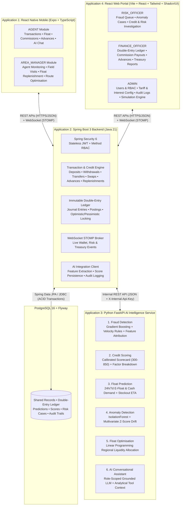

# System Architecture — AI-Powered Digital Agent Banking & Float Management Platform

## 1. Architectural Vision & Alignment

This platform implements a production-grade, four-application distributed architecture backed by a shared PostgreSQL persistence layer, matching the reference system architecture:

1. **Application 1 — React Native Mobile (`mobile-app/`)**: Field operations application built with Expo and TypeScript for `AGENT` and `AREA_MANAGER` roles, communicating exclusively with the Spring Boot Backend over REST APIs and WebSockets.
2. **Application 2 — Spring Boot Backend (`backend/`)**: Central authoritative core built with Java 21 and Spring Boot 3, owning authentication, role-based access control (RBAC), the double-entry financial ledger, the transaction and credit engine, real-time WebSocket event streaming, and orchestration of AI intelligence calls.
3. **Application 3 — AI Intelligence Service (`ai-service/`)**: Python FastAPI microservice hosting six explainable AI/ML capabilities—**Fraud Detection**, **Credit Scoring**, **Float Prediction**, **Anomaly Detection**, **Float Optimisation**, and **AI Assistant**—invoked by Spring Boot over internal REST APIs.
4. **Application 4 — React Web Portal (`web-portal/`)**: Oversight, treasury, and administration web application built with React, Vite, TypeScript, Tailwind CSS, and Shadcn/UI for `RISK_OFFICER`, `FINANCE_OFFICER`, and `ADMIN` roles.
5. **Shared Persistence — PostgreSQL (`postgres`)**: Relational ACID database managed through Flyway versioned migrations, storing shared operational records, double-entry ledger postings, predictions, credit/fraud scores, risk cases, and immutable audit trails.



---

## 2. Core Architectural Principles & Non-Negotiable Invariants

### 2.1 Backend Authority & Zero Frontend Financial Logic
- **Single Financial Authority**: All fee calculations, commission accruals, daily/term interest computations, credit limit checks, and account balance updates execute exclusively inside Spring Boot `@Transactional` services using `java.math.BigDecimal` (`NUMERIC(19,4)`, `RoundingMode.HALF_EVEN`).
- **No Hardcoded Frontend Balances**: Mobile and Web clients never compute or store authoritative balances locally; all displayed balances, KPIs, statements, and charts come from live REST endpoints and real-time WebSocket events.
- **Simulated Banking Boundary**: External payment rails (card networks, central bank RTGS, mobile money switches) are cleanly simulated inside the platform's settlement clearing accounts (`CENTRAL_RESERVE_POOL`, `CUSTOMER_DIGITAL_CLEARING`) without external third-party payment gateways.

### 2.2 Strict Double-Entry Financial Ledger
- Every financial event creates an immutable `journal_entry` header with two or more `ledger_postings` (`DEBIT` or `CREDIT`).
- **Zero-Imbalance Invariant**: Before any journal entry commits, the ledger engine validates:
  $$\sum_{i} \text{Debit}_i = \sum_{j} \text{Credit}_j > 0$$
- **Concurrency Safety**: High-contention wallet accounts acquire deterministic ordered row locks (`SELECT ... FOR UPDATE` ordered by `account_id ASC` to prevent deadlocks) combined with JPA `@Version` optimistic locking and client `Idempotency-Key` deduplication.
- **No Destructive Edits**: Posted ledger rows are append-only. Reversals or adjustments generate compensating journal entries referencing `reversal_of_entry_id`.

### 2.3 Defense-in-Depth Role-Based Access Control (RBAC)
Permissions are enforced at three backend layers—URL filter chains, `@PreAuthorize` method security, and resource-ownership checks (e.g., an `AGENT` can only transact from their own agent profile; an `AREA_MANAGER` can only replenish agents assigned to their region):

| Role | Target Client | Core Authorised Capabilities |
| :--- | :--- | :--- |
| `AGENT` | React Native Mobile | Execute customer deposits, withdrawals, money transfers; initiate/accept peer float exchanges; apply for/repay float advances; view own wallet ledger & commissions; request commission payout; use Agent AI Assistant & own float forecast. |
| `AREA_MANAGER` | React Native Mobile | Monitor assigned regional agents in real time; log & verify field visits; execute regional float replenishments; trigger & apply AI regional float allocation optimisation; use Manager AI Assistant. |
| `RISK_OFFICER` | React Web Portal | Monitor real-time fraud & anomaly alerts; inspect explainable AI fraud/credit/anomaly breakdowns; manage risk investigation cases; place/lift temporary transaction holds on high-risk agents; use Risk AI Assistant. |
| `FINANCE_OFFICER` | React Web Portal | Inspect general ledger, trial balance, income statement, and journal entries; approve/reject large float advances; run interest accrual cycles; disburse accrued agent commissions; fund regional manager float pools; run financial reports. |
| `ADMIN` | React Web Portal | Manage users, roles, regions, and agent assignments; configure fee/commission tariffs, interest tiers, and risk thresholds; inspect immutable system audit logs; trigger multi-agent simulation scenarios. |

### 2.4 Explainable AI by Design
- Every AI endpoint returns structured **explainability artefacts** alongside its prediction or recommendation:
  - Top contributing features (`feature_name`, `feature_value`, `contribution_weight`, `direction`).
  - Human-readable `summary_rationale` and `recommended_actions`.
  - Model metadata (`model_name`, `model_version`, `confidence_score`, `evaluated_at`).
- Spring Boot persists every AI inference and explanation into PostgreSQL so Risk Officers, Finance Officers, and Auditors can reconstruct *why* a transaction was flagged, *why* an agent received a given credit limit, or *why* regional liquidity was allocated in specific proportions.

---

## 3. Repository & Monorepo Directory Structure

```text
agent-banking-ai-platform/
├── docs/
│   ├── SYSTEM_ARCHITECTURE.md
│   ├── DATABASE_DESIGN.md
│   ├── API_SPECIFICATION.md
│   ├── AI_ARCHITECTURE.md
│   ├── IMPLEMENTATION_ROADMAP.md
│   └── DEVELOPMENT_CHECKLIST.md
├── backend/                        # Java 21 + Spring Boot 3 (Maven)
│   ├── Dockerfile
│   ├── pom.xml
│   └── src/
│       ├── main/
│       │   ├── java/com/agentbanking/platform/
│       │   │   ├── auth/           # JWT, Spring Security, User & Role auth
│       │   │   ├── agent/          # Agent profiles, territories, field visits
│       │   │   ├── ledger/         # Double-entry accounts, journals, postings
│       │   │   ├── transaction/    # Deposits, withdrawals, transfers, peer swaps, replenishments
│       │   │   ├── credit/         # Float advances, credit scoring sync, interest engine
│       │   │   ├── commission/     # Tariff calculation, accruals, disbursements
│       │   │   ├── risk/           # Fraud alerts, anomaly flags, investigation cases
│       │   │   ├── ai/             # FastAPI integration client, forecasts, optimisation, assistant proxy
│       │   │   ├── reporting/      # Trial balance, P&L, liquidity & executive reports
│       │   │   ├── simulation/     # Deterministic/stochastic simulation scenario runner
│       │   │   ├── audit/          # Immutable audit trail interceptor & queries
│       │   │   ├── websocket/      # STOMP WebSocket config & real-time event publisher
│       │   │   └── common/         # Exceptions, DTOs, OpenAPI config, money utilities
│       │   └── resources/
│       │       ├── application.yml
│       │       └── db/migration/   # Flyway SQL migrations (V1..V4)
│       └── test/                   # JUnit 5 + Spring Boot integration & ledger tests
├── ai-service/                     # Python 3.11+ FastAPI + scikit-learn + SciPy + LLM
│   ├── Dockerfile
│   ├── requirements.txt
│   ├── app/
│   │   ├── main.py
│   │   ├── config.py
│   │   ├── schemas/                # Pydantic v2 request/response + explainability models
│   │   ├── models/                 # Trained/calibrated scikit-learn pipelines & registry
│   │   ├── services/
│   │   │   ├── fraud_detector.py
│   │   │   ├── credit_scorer.py
│   │   │   ├── float_forecaster.py
│   │   │   ├── anomaly_detector.py
│   │   │   ├── float_optimiser.py
│   │   │   └── assistant_service.py
│   │   └── routers/
│   └── tests/                      # Pytest suite for all 6 AI modules
├── mobile-app/                     # React Native + Expo + TypeScript (AGENT & AREA_MANAGER)
│   ├── package.json
│   ├── app.json
│   └── src/
│       ├── api/                    # Axios REST client + STOMP/WebSocket hook
│       ├── auth/                   # Auth context & secure token storage
│       ├── screens/
│       │   ├── agent/              # Dashboard, Cash-In/Out, Transfers, Swaps, Advances, Commissions, AI Chat
│       │   └── manager/            # Regional Map/List, Agent Drilldown, Replenishment, Field Visits, AI Optimiser
│       ├── components/             # Shared UI cards, explainability badges, ledger rows
│       └── types/
├── web-portal/                     # React + Vite + TypeScript + Tailwind CSS + Shadcn/UI
│   ├── Dockerfile
│   ├── package.json
│   └── src/
│       ├── api/                    # Typed API client + WebSocket live subscriptions
│       ├── components/ui/          # Shadcn/UI primitives
│       ├── layouts/                # Role-aware shell (Risk, Finance, Admin)
│       ├── pages/
│       │   ├── auth/
│       │   ├── risk/               # Fraud/Anomaly Queue, Case Workbench, Credit & Explainability Explorer
│       │   ├── finance/            # General Ledger, Trial Balance, Advances, Commissions, Float Forecast/Optimiser
│       │   └── admin/              # Users & Agents, System Config, Simulation Studio, Audit Logs
│       └── types/
└── docker-compose.yml              # Orchestrates postgres, ai-service, backend, web-portal (+ Expo connectivity)
```

---

## 4. Communication & Real-Time Event Flows

### 4.1 Synchronous Transaction + Inline AI Fraud Screening Flow
1. **Mobile Client (`AGENT`)** submits `POST /api/v1/transactions/cash-withdrawal` with `Authorization: Bearer <jwt>` and `Idempotency-Key: <uuid>`.
2. **Spring Boot Backend**:
   - Validates JWT, verifies `AGENT` role and active (non-frozen) status.
   - Checks idempotency table to guarantee exact-once execution.
   - Computes customer fee and agent commission from configured `tariff_rules`.
   - Extracts real-time velocity and behavioural features (last 1h/24h tx count, amount z-score against agent baseline, time-of-day, float ratio) and invokes `ai-service` `POST /internal/ai/v1/fraud/evaluate` + `/anomaly/evaluate`.
   - If fraud risk exceeds the critical auto-block threshold (e.g., `fraud_score >= 0.92` and policy = `BLOCK`), records a blocked attempt, raises a `HIGH`/`CRITICAL` `risk_alert`, broadcasts to `/topic/risk/alerts`, and returns a structured rejection with explainable reason codes.
   - Otherwise, locks involved `ledger_accounts` in deterministic ID order, verifies sufficient balance (`AGENT_CASH >= amount`), writes balanced `journal_entry` + `ledger_postings`, updates cached account balances atomically, persists the transaction + fraud evaluation, and commits.
3. **Post-Commit Real-Time Broadcast**:
   - Publishes updated wallet balances to `/topic/agents/{agentId}/wallet`.
   - Publishes transaction ticker event to `/topic/finance/transactions`.
   - If E-Float or Cash drops below the agent's low-liquidity threshold or fraud score >= warning threshold (`0.60`), publishes alert to `/topic/regions/{regionId}/alerts` and `/topic/risk/alerts`.

### 4.2 WebSocket Channels (STOMP over `/ws`)
- `/topic/agents/{agentId}/wallet` — Instant E-Float, Physical Cash, Accrued Commission, and Active Loan balance updates.
- `/topic/regions/{regionId}/monitoring` — Live regional liquidity updates and stockout warnings for Area Managers.
- `/topic/risk/alerts` — Real-time fraud flags, anomaly detections, and new investigation triggers for Risk Officers.
- `/topic/finance/ledger` — Live journal entry stream, advance requests, and commission disbursement notifications for Finance Officers.

---

## 5. Security, Auditability & Resilience

- **Authentication**: BCrypt-hashed credentials (`cost=12`), short-lived signed JWT access tokens (`HS256`/`RS256` with role claims, `userId`, `agentId`, `regionId`) plus refresh token rotation.
- **Service-to-Service Security**: Internal calls between Spring Boot and FastAPI use network isolation in Docker Compose plus a shared `X-Internal-Api-Key` header. Frontends never call FastAPI directly; all AI calls pass through Spring Boot for RBAC enforcement, data grounding, and audit logging.
- **Resilience**: If the AI service experiences transient latency during a live transaction, Spring Boot applies configurable circuit-breaker/timeout fallback rules (deterministic velocity & threshold scoring logged with `model_version = "FALLBACK_DETERMINISTIC_V1"`) so core ledger integrity is never compromised.
- **Audit Trail**: Every authentication event, transaction, advance approval, commission payout, parameter change, and risk status override writes an append-only row to `audit_logs` capturing `actor_user_id`, `actor_role`, `action_type`, `entity_type`, `entity_id`, `before_state` (JSONB), `after_state` (JSONB), `ip_address`, and `created_at`.
